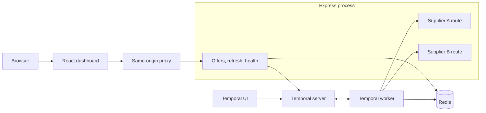
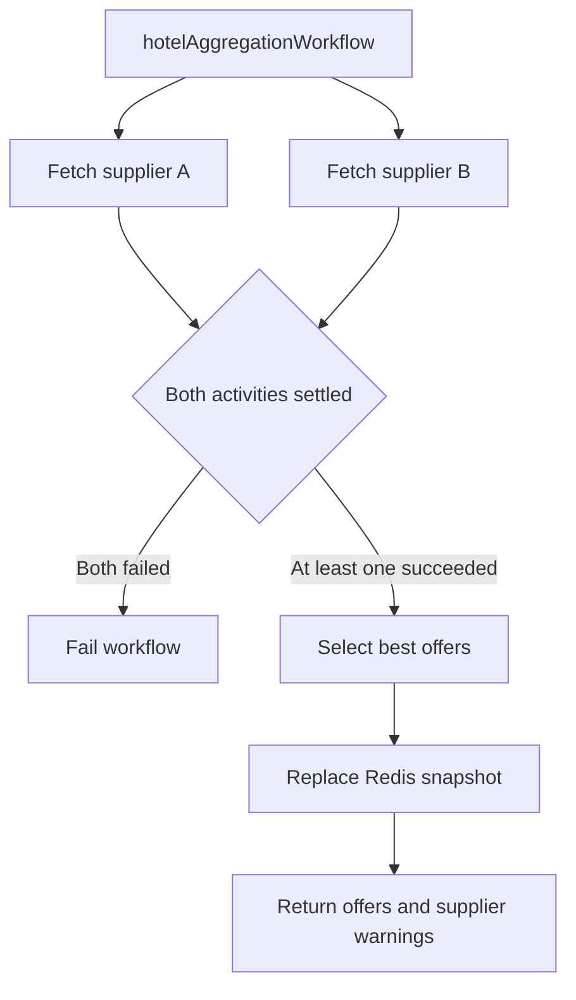
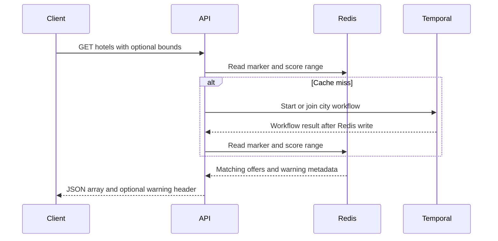
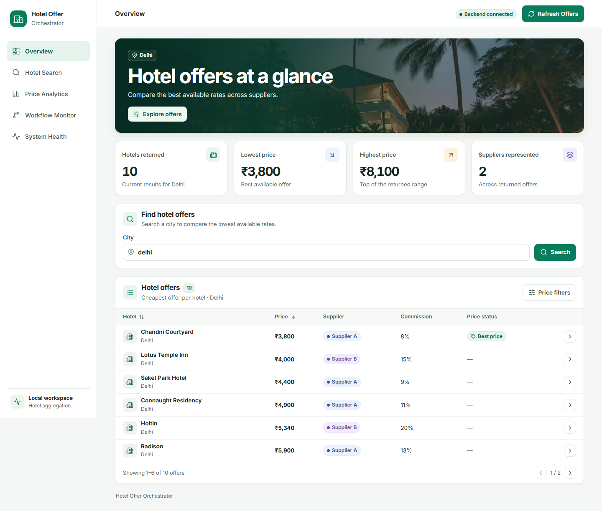

# Hotel Offer Orchestrator

Hotel Offer Orchestrator is a hotel comparison dashboard and TypeScript API. Temporal fetches two supplier feeds concurrently, the worker keeps the cheapest offer per normalized hotel name, and Redis serves price-filtered results. The dashboard shows prices, supplier commissions, current-snapshot analytics, and service health.

Delhi has seven mock listings per supplier and ten unique hotels. Mumbai has an intentionally empty catalog for testing. Start with [Docker Compose setup](#run-with-docker-compose), then use the [five-minute demo](DEMO_GUIDE.md) and [interview preparation notes](INTERVIEW_PREPARATION.md).

## Stack and architecture

Node.js 22 LTS (22.12+), strict TypeScript, Express 5, Temporal, Redis 7, React, Vite, Tailwind CSS, React Router, TanStack Query, Recharts, Lucide, Vitest, Playwright, Docker Compose, and Postman.



The API validates requests, reads the cache, and starts or joins a workflow on a miss. The separately launched worker executes activities. Temporal records activity scheduling, results, and retries in workflow history. If the worker restarts, Temporal can continue execution from recorded history. A pair of HTTP promises in an Express handler lives only for that process and request.



The workflow dispatches both supplier activities in the same workflow task and awaits them together. Activities perform HTTP calls, deduplication, and Redis writes. Names are normalized with Unicode NFKC, lowercasing, trimming, and whitespace collapse. The lowest price wins, followed by Supplier A on a cross-supplier tie and the first listing on a tie within one feed. The winning listing supplies the display name and commission.



## Redis and refresh

- `hotels:<city>` is a sorted set. Each member is a JSON offer and its score is the price. `ZRANGEBYSCORE` returns matching members in ascending price order, with inclusive endpoints and infinities for omitted bounds. Redis searches the price index and returns only matching rows.
- `hotels:<city>:status` stores the failed-supplier array. A present marker with an absent sorted set represents a successfully cached empty catalog.
- Writes delete the previous set and install the current snapshot and expiry in one transaction. A read transaction retrieves the marker and bounded results together. The cache lasts 300 seconds for complete results and 30 seconds for partial results by default. Use a standalone Redis instance with `noeviction` so Redis cannot evict one key in a snapshot independently.
- Requests share a pending city aggregation in each API process. The Temporal ID `hotel-aggregation:<city>` and the `USE_EXISTING` policy also prevent overlapping executions for that city across API processes. A closed ID can be reused.
- `POST /api/hotels/refresh?city=delhi` starts or joins an aggregation immediately. Normal reads can still serve the previous snapshot while a refresh is running.

## Run with Docker Compose

Use Docker Desktop or Docker Engine with Compose v2. The copy step is optional when using defaults. On Windows use PowerShell, or use `cp .env.example .env` in a POSIX shell.

```powershell
if (-not (Test-Path .env)) { Copy-Item .env.example .env }
docker compose up --build --wait
docker compose ps
```

| Service | Address or role |
| --- | --- |
| React dashboard | http://127.0.0.1:5173 |
| API and both mock supplier routes | http://localhost:3000 |
| Worker | Internal process polling the hotel-offers task queue |
| Temporal | localhost:7233 for local SDK clients |
| Temporal UI | http://localhost:8080 |
| Redis | redis:6379 on the Compose network, with an append-only file on a named volume |

Host ports bind to loopback. API and worker containers run as a non-root user with Linux capabilities dropped and privilege escalation disabled. The runtime image excludes build tooling and the base image's package managers. Run `docker compose down` to stop the stack and preserve the Redis volume. The bundled Temporal server runs in development mode and its workflow history is ephemeral across container recreation. Before internet-facing deployment, use a durable Temporal service, secure Temporal and Redis access, and put the API behind TLS with authentication and request limits for refresh.

If port 3000 is occupied, set `PORT=13000` in .env and use port 13000 for API requests and the Postman collection.

### Frontend routes

| Page | Route | Data and actions |
| --- | --- | --- |
| Overview | `/` | Current city summary, search, cheapest offer highlight, and refresh |
| Hotel Search | `/hotels` | Inclusive minimum and maximum prices, sortable and paginated offers, and offer details |
| Price Analytics | `/analytics` | Returned-price distribution, supplier share, average price, and the five cheapest offers |
| Workflow Monitor | `/workflows` | Workflow type and ID to look up in Temporal UI, plus namespace health |
| System Health | `/health` | API, Redis, Temporal, and supplier health with manual refresh and 30-second polling |

The frontend keeps submitted city and price filters in the URL. TanStack Query keys offer data by those parameters, and every price range is sent to Redis through the existing API. The frontend displays the backend's deduplicated offers and partial-supplier warning header. Refresh posts to the existing endpoint, then updates the unfiltered cache entry and reloads the currently active filtered results. Analytics describe the current results. The backend exposes no workflow execution API, so the dashboard links to Temporal UI for run history.

### Frontend development

With the backend running and Node.js 22.13+ or 24 LTS installed, open a PowerShell session in the project root:

```powershell
if (-not (Test-Path frontend/.env)) { Copy-Item frontend/.env.example frontend/.env }
npm.cmd --prefix frontend ci
npm.cmd --prefix frontend run dev
```

Copy the template only if `frontend/.env` does not exist. The template proxies to the API on port 13000. Set `API_PROXY_TARGET=http://127.0.0.1:3000` when using the default API port. Stop the Compose frontend if it already owns port 5173 before starting Vite locally.

| Variable | Where it applies | Default |
| --- | --- | --- |
| `FRONTEND_PORT` | Compose host port | `5173` |
| `VITE_API_BASE_URL` | Compose build argument or frontend build environment | `/gateway` |
| `API_PROXY_TARGET` | Local Vite development proxy | `http://127.0.0.1:3000` |
| `VITE_TEMPORAL_UI_URL` | Compose build argument or frontend build environment | `http://127.0.0.1:8080` |
| `VITE_DISPLAY_CURRENCY` | Compose build argument or frontend build environment | `INR` |

The mock API returns numeric amounts with no currency code. The UI presents Delhi prices in INR by default. The display setting changes formatting and does not convert amounts. Vite proxies `/gateway` during development, and Nginx proxies the offer and health endpoints to `api:3000` in Compose. Both preserve the browser Host header for the existing same-origin refresh check. Use a same-origin proxy with standalone production builds. Frontend build variables are public configuration and must not contain secrets.

### Frontend checks

```powershell
npm.cmd --prefix frontend run typecheck
npm.cmd --prefix frontend run build
npm.cmd --prefix frontend run lint
npm.cmd --prefix frontend test
npm.cmd --prefix frontend exec -- playwright install chromium
npm.cmd --prefix frontend run test:browser
```

Run browser tests against a healthy Compose stack. Set `PLAYWRIGHT_CHANNEL=msedge` to use an installed Edge browser. Set `TEST_FRONTEND_URL` when using a different frontend port. The normal suite covers API-backed search, price bounds, clearing filters, refresh, health, navigation, and four viewports. The separate outage test checks one supplier at a time. Set `DOCKER_SUPPLIER_A_URL=http://api:9` or `DOCKER_SUPPLIER_B_URL=http://api:9`, then run `docker compose up -d --no-build --no-deps api worker`. Set `TEST_SUPPLIER_OUTAGE` to the matching letter (`A` or `B`) and run `npm.cmd --prefix frontend run test:browser -- outage.spec.ts`. Clear both variables afterward and follow the restore procedure in the [demo guide](DEMO_GUIDE.md).

### Frontend troubleshooting

- If the dashboard reports the backend is unavailable, check `docker compose ps` and open the API's direct `/health` endpoint. Use the port configured through `PORT`.
- If local Vite calls target the wrong backend, check `API_PROXY_TARGET` in `frontend/.env` and restart Vite.
- If refresh reports an origin mismatch, use the dashboard's `/gateway` proxy. The backend checks the browser's Origin header.
- If another app owns port 5173, set `FRONTEND_PORT` in the root environment for Compose and update `TEST_FRONTEND_URL` when testing.

### Screenshots



[Hotel Search](docs/screenshots/hotel-search.png) · [Price Analytics](docs/screenshots/price-analytics.png) · [Workflow Monitor](docs/screenshots/workflow-monitor.png) · [System Health](docs/screenshots/system-health.png) · [Degraded Health](docs/screenshots/degraded-health.png) · [Mobile Overview](docs/screenshots/mobile-overview.png)

The screenshots were captured from the running Compose dashboard. The banner photograph is decorative. [Palm Trees at Night by Pixabay on Pexels](https://www.pexels.com/photo/palm-trees-at-night-258154/)

## Run Node processes locally

Install Node.js 22 LTS (22.12+) or 24 LTS and have a Redis server listening at port 6379 and a Temporal server at port 7233. For local development with the Temporal CLI, run `temporal server start-dev`.

```sh
npm ci
npm run build
npm start
```

In a second terminal, run `npm run worker`. Start the API before sending aggregation requests so the mock feeds are reachable.

In Windows PowerShell, use `npm.cmd` in place of `npm` if script execution policy blocks the PowerShell shim. Use the same `PORT` value in the API and worker terminals.

| Setting | Default outside Compose |
| --- | --- |
| PORT | 3000 |
| HOST | 127.0.0.1 |
| REDIS_URL | redis://localhost:6379 |
| TEMPORAL_ADDRESS | localhost:7233 |
| TEMPORAL_NAMESPACE | default, which must exist on the Temporal server |
| TEMPORAL_TASK_QUEUE | hotel-offers |
| SUPPLIER_A_URL, SUPPLIER_B_URL | API origin on the configured port |
| CACHE_TTL_SECONDS | 300 |
| PARTIAL_CACHE_TTL_SECONDS | 30 |

Compose uses network addresses and keeps the container port at 3000. Set `DOCKER_REDIS_URL`, `DOCKER_TEMPORAL_ADDRESS`, `DOCKER_SUPPLIER_A_URL`, or `DOCKER_SUPPLIER_B_URL` in .env to override internal addresses. Compose builds Temporal, Temporal UI, and Redis from pinned Alpine-based upstream images and applies available distribution package updates. Use `TEMPORAL_IMAGE`, `TEMPORAL_UI_IMAGE`, or `REDIS_IMAGE` with compatible Alpine-based image references to update them. Run `docker compose build --no-cache temporal temporal-ui redis` to refresh the package update layers. For refresh behind a proxy, preserve the public host and enforce authentication and the browser-origin policy at the public edge. The built-in origin check uses the protocol seen by Express.

## HTTP API

| Method and path | Result |
| --- | --- |
| GET /api/hotels?city=delhi | All ten aggregated offers |
| GET /api/hotels?city=delhi&minPrice=4000 | Offers priced at least 4000 |
| GET /api/hotels?city=delhi&maxPrice=7000 | Offers priced at most 7000 |
| GET /api/hotels?city=delhi&minPrice=5340&maxPrice=5900 | Offers in the inclusive range |
| GET /api/hotels?city=mumbai | Empty array |
| POST /api/hotels/refresh?city=delhi | Rebuilt offer snapshot |
| GET /supplierA/hotels?city=delhi | Raw Supplier A listings |
| GET /supplierB/hotels?city=delhi | Raw Supplier B listings |
| GET /health | API, Redis, Temporal and both supplier statuses |

```powershell
curl.exe "http://127.0.0.1:3000/api/hotels?city=delhi&minPrice=5340&maxPrice=5900"
curl.exe -X POST "http://127.0.0.1:3000/api/hotels/refresh?city=delhi"
```

```json
[
  {"name":"Holtin","price":5340,"supplier":"Supplier B","commissionPct":20},
  {"name":"Radison","price":5900,"supplier":"Supplier A","commissionPct":13}
]
```

Both supplier routes return arrays of raw listings. For example, Supplier A returns `{"hotelId":"a1","name":"Holtin","price":6000,"city":"delhi","commissionPct":10}`. Refresh returns the same offer-array format as GET. The Postman collection includes examples for both feeds, health, refresh, and validation errors.

City names are case-insensitive. Prices are finite non-negative decimal strings. Missing or unsupported cities, invalid prices, and reversed ranges give HTTP 400 with a stable error code and message. A valid query with no matches returns HTTP 200 and `[]`. The API sends no CORS allow headers. Refresh accepts an absent `Origin` for CLI clients and rejects cross-origin browser requests with HTTP 403. This check is independent of authentication.

### Failure and health behavior

- Fetches time out after 2.5 seconds and cap decoded response bodies at 256 KiB. Redirects, oversized responses, and invalid JSON or schema fail that supplier immediately. Only defined listing fields are sent to Temporal. A valid empty feed counts as successful. Activities have a 5-second attempt limit, a 20-second scheduling budget, and up to three attempts with exponential backoff.
- One failed supplier yields HTTP 200 with the surviving offers and the `X-Hotel-Failed-Suppliers` header. Cached partial reads include that same header. Both suppliers failing makes the workflow fail and the API returns 503. Workflow execution and client waits are bounded.
- Redis and aggregation outages return structured 503 errors. Logs carry timestamps, event names and city or supplier context. The worker drains on SIGTERM or SIGINT.
- Health probes Redis PING, the configured Temporal namespace, and both HTTP supplier feeds. Healthy responses use 200. A supplier outage alone yields `degraded` and 503, while Redis or Temporal failure yields `unhealthy` and 503. The integration test verifies worker operation by executing a workflow.

## Tests and Postman

```sh
npm ci
npm run build
npm test
docker build --target test .
docker compose up --build --wait
npm run test:integration
```

Vitest covers input validation, best offer selection, cache reuse, supplier and health routes, and workflow failure paths with mocked activities. The Compose tests inspect Temporal history for both supplier activities scheduled by the same workflow task, check the winning offers, and compare Redis command counters and Temporal run IDs across filtered reads. They also use a temporary Redis key to verify snapshot replacement, both TTLs, and the difference between an expired and an empty catalog.

Import `postman/Hotel-Offer-Orchestrator.postman_collection.json` into Postman. Run the requests with the collection's default `baseUrl` of `http://localhost:3000`. Each request includes an HTTP status assertion and an example response.

## Technical demonstration

1. Start Compose and check `/health`. Open both supplier endpoints and compare the Holtin, Radison, and Aerocity Grand prices and commissions.
2. Call `GET /api/hotels?city=delhi`. On a cold cache it runs the workflow. Use the refresh endpoint for a repeatable demonstration.
3. Open the Temporal UI, select `hotel-aggregation:delhi`, and inspect the event history for both fetch activities, deduplication, and the Redis write.
4. Call the price-range example and inspect Redis with `docker compose exec redis redis-cli ZRANGEBYSCORE hotels:delhi 5340 5900 WITHSCORES`. Reload Temporal UI to confirm the filtered request reused the cache.
5. Request Mumbai and a reversed price range. The first returns an empty array and the second returns a validation error. Run the automated suites for a repeatable verification.

## Repository layout

```text
src/app.ts                 Routes, validation and error middleware
src/server.ts              API composition, probes and process lifecycle
src/services/              Supplier HTTP, best-offer logic, cache and Temporal client
src/suppliers/             Deterministic mock data
src/temporal/              Workflow, activities and worker entry point
tests/                     Vitest suite
integration/               Live Compose verification
postman/                   Importable API collection and examples
frontend/                  React app, API client, proxy, and browser tests
docs/screenshots/          Captures from the running dashboard
Dockerfile                 App runtime and unit-test build stages
Dockerfile.dependencies    Upstream dependency images with package updates
docker-compose.yml         Six-service local deployment
```

Future work includes supplier onboarding, currency normalization, metrics and distributed tracing, authenticated refresh, and workflow versioning for coordinated deployments.
