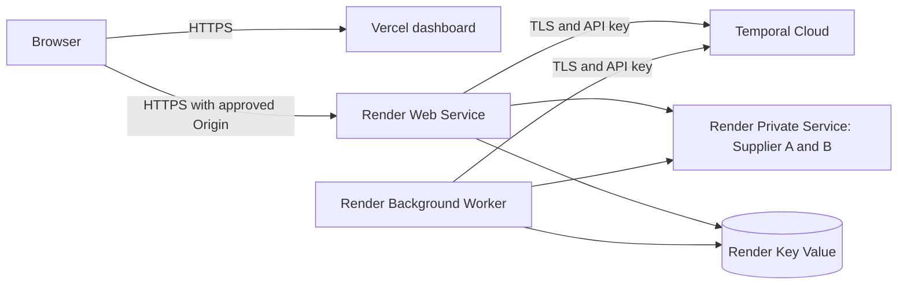

# Render and Vercel deployment

Deploy the [Hotel Offer Orchestrator repository](https://github.com/dapinderbhullar/HotelOfferOrchestartor) from `main` after the deployment configuration is committed to that branch. The Vercel dashboard calls the Render API over HTTPS. The Render API and worker use private networking for the mock suppliers and cache, and TLS for Temporal Cloud.



## 1. Prepare Temporal Cloud and the Vercel domain

1. In [Temporal Cloud](https://cloud.temporal.io/), open **Namespaces**, choose **New Namespace**, and create an API-key-authenticated namespace such as `hotel-offer-prod`. Use a region near the Render services, which the Blueprint puts in Oregon. Copy the full namespace ID, including the account suffix, and the namespace gRPC endpoint. The endpoint normally looks like `<namespace>.<account>.tmprl.cloud:7233`. Use the API-key endpoint shown for your namespace. [Temporal namespace setup and endpoints](https://docs.temporal.io/cloud/namespaces)
2. Use the namespace's **Access** settings to create a namespace-scoped service account with **Write** permission. If creating it from **Identities → Create Service Account**, use the **Read** account role and grant **Write** only on the deployment namespace. In **API Keys → Create API Key**, choose **Service Account** and select that identity, or use the key prompt after creation. Save the key and expiry securely. You can use one key for initial setup or issue separate keys for the API and worker. The SDK enables TLS automatically when `TEMPORAL_API_KEY` is set. [Temporal service accounts](https://docs.temporal.io/cloud/manage-access/service-accounts) · [Temporal API key management](https://docs.temporal.io/cloud/api-keys)
3. In [Vercel](https://vercel.com/), identify the project's stable Production domain under **Settings → Domains**, or choose the project name and a stable domain during import. This domain becomes the API's allowlisted origin. Use the full HTTPS origin with no trailing slash, for example `https://your-project.vercel.app`. If the domain is unknown during Blueprint creation, leave the allowlist empty in a manual setup or use `https://pending.invalid` as a temporary Blueprint input. Replace it with the actual Production origin before browser verification.

## 2. Deploy on Render

Keep all four Render resources in one workspace and region. The Blueprint uses **Oregon** and paid instance plans. Preview the cost before applying it. In the [Render dashboard](https://dashboard.render.com/), choose **New → Blueprint**, select the existing GitHub repository and `main`, and select the root [`render.yaml`](../render.yaml). Review the proposed resources and enter the prompted values from the table below. You can run `render blueprints validate render.yaml` with Render CLI 2.7.1 or later before applying. [Render Blueprint specification](https://render.com/docs/blueprint-spec) · [Render validator documentation](https://render.com/docs/cli-reference#blueprints)

If creating resources manually, use the same names and settings. For each Docker service, use the repository root for **Root Directory** and **Docker Build Context** (`.`) and `./Dockerfile` for **Dockerfile Path**. Render runs the Dockerfile build, including `npm ci`, TypeScript compilation, and pruning dev packages. Leave native Build and Start Command fields unused. Set the Docker Command only when shown in the table.

| Resource | Render type | Plan | Docker context and file | Startup and checks |
| --- | --- | --- | --- | --- |
| `hotel-offer-api` | Web Service | `0.5c-512mb` | `.`, `./Dockerfile` | Docker default `node dist/server.js`. Health path `/ready`. Shutdown allowance 85 seconds. |
| `hotel-offer-worker` | Background Worker | `0.5c-512mb` | `.`, `./Dockerfile` | Docker Command `node dist/temporal/worker.js`. Shutdown allowance 20 seconds. |
| `hotel-offer-suppliers` | Private Service | `0.5c-512mb` | `.`, `./Dockerfile` | Docker Command `node dist/supplier-server.js`. Internal port 10000. |
| `hotel-offer-cache` | Key Value | `256mb` | Managed service | External IP allowlist empty, `noeviction`, journal snapshots. |

Render's Web Service supplies `PORT` (default 10000). The API and supplier adapters listen on `0.0.0.0`. The private service contains both existing mock routes, so it costs one instance and preserves their contracts. A process outage can affect both feeds. One-feed failures still produce partial results. Only the Web Service has a public Render URL. The private supplier address is injected as `host:port`, and its presence keeps the two raw supplier routes off the public API. [Render private networking](https://render.com/docs/private-network) · [Render health checks](https://render.com/docs/health-checks)

**Dependency order.** Create the Temporal namespace and API keys first, then provision the cache and private supplier service. Start the worker and API once the dependencies are reachable, then deploy Vercel with the API URL. The Blueprint supplies references automatically. During initial provisioning, startup retries and Render health checks accommodate staggered starts. An API `/ready` response confirms Redis and Temporal namespace connectivity. Confirm the worker by executing a refresh and inspecting its workflow history.

### Render environment checklist

| Variable | Service | Exact value or source | Secret |
| --- | --- | --- | --- |
| `HOST` | API and suppliers | `0.0.0.0` | No |
| `PORT` | API | Render-injected, typically `10000` | No |
| `PORT` | Suppliers | `10000` | No |
| `CORS_ALLOWED_ORIGINS` | API | Stable browser origin from Vercel Domains. Comma-separate any additional exact trusted origins. | No |
| `TEMPORAL_ADDRESS` | API and worker | Namespace or API-key gRPC endpoint copied from Temporal Cloud, including `:7233`, without a scheme. | No |
| `TEMPORAL_NAMESPACE` | API and worker | Full namespace ID from Temporal Cloud, including account suffix. | No |
| `TEMPORAL_API_KEY` | API and worker | The corresponding service-account key entered into Render, never a build argument. | **Yes** |
| `TEMPORAL_TASK_QUEUE` | API and worker | `hotel-offers` on both services. | No |
| `REDIS_URL` | API and worker | Render Key Value `connectionString` reference, or **Connect → Internal** URL when setting it manually. | **Yes when authenticated** |
| `SUPPLIER_PRIVATE_ADDRESS` | API and worker | Private supplier `hostport` reference, or **Connect → Internal** address without a scheme. | No, internal only |
| `CACHE_TTL_SECONDS`, `PARTIAL_CACHE_TTL_SECONDS` | Worker | Optional overrides. Defaults are `300` and `30`. | No |

Keep `SUPPLIER_A_URL` and `SUPPLIER_B_URL` unset on Render unless intentionally routing a supplier to a different private endpoint. Use the full internal Redis connection string exactly as issued. The Redis client supports authenticated `redis://` and `rediss://` URLs. For a new Key Value instance, enable internal authentication under **Info → Connections** before admitting traffic, then verify both consumers have the resulting authenticated connection string. After changing authentication on an existing instance, confirm the reference refreshed and redeploy API and worker. If using manual environment settings, replace both values with the new Internal URL. Keep external access disabled. [Render Key Value and internal authentication](https://render.com/docs/key-value)

## 3. Deploy on Vercel

In Vercel, import the existing GitHub repository or edit the connected project. Use these settings and save before deploying.

| Vercel setting | Value |
| --- | --- |
| Production Branch | `main` |
| Root Directory | `frontend` |
| Framework Preset | Vite |
| Node.js Version | 24.x |
| Install Command | `npm ci` |
| Build Command | `npm run build` |
| Output Directory | `dist` |

[`frontend/vercel.json`](../frontend/vercel.json) configures the build and SPA routing so a direct visit to `/hotels`, `/analytics`, `/workflows`, or `/health` loads the React app. [Vite SPA routing on Vercel](https://vercel.com/docs/frameworks/frontend/vite)

Under **Settings → Environment Variables**, set the following for **Production**:

| Variable | Value |
| --- | --- |
| `VITE_API_BASE_URL` | Public HTTPS origin from the Render Web Service dashboard. Use its actual deployed URL with no `/api` or `/gateway` suffix. |
| `VITE_DISPLAY_CURRENCY` | Optional. Default is `INR`. |
| `VITE_TEMPORAL_UI_URL` | Optional. Leave unset for a public dashboard. For an operator link, use the authenticated Temporal Cloud namespace console URL. |

All `VITE_*` values are public browser configuration. Keep Redis credentials and Temporal API keys exclusively on Render. Deploy or redeploy Vercel after changing build-time variables. Confirm the actual production origin is in the API's `CORS_ALLOWED_ORIGINS`, then redeploy the API after environment changes. Preview deployments need an explicit origin or a stable preview domain and separate approval in the API allowlist. Use a separate backend and namespace when preview traffic should be isolated. [Vercel environment variables](https://vercel.com/docs/environment-variables)

## 4. Redeploy and rotate credentials

- Commit and push verified changes to the branch connected to Render and Vercel. Check **Events / Deploys** on Render and **Deployments** on Vercel for the matching commit. Use the dashboards' manual redeploy options if automatic deployment is off.
- When rotating Temporal keys, install the replacement on both Render services, redeploy them, verify a refresh, then revoke the old key. No code rebuild is required for credential rotation. [Temporal API key rotation guidance](https://docs.temporal.io/cloud/api-keys)
- The worker uses Temporal's native client polling and retry behavior and keeps its graceful signal handling. If the process exits, inspect the Render worker logs for the failure and check the deployed namespace credentials before restarting. `worker.ready` alone does not prove the worker can process a task. Use the smoke test.

## 5. Smoke tests after deployment

Use the assigned URLs in PowerShell and replace the illustrative origins. The authenticated Temporal Cloud console is the place to verify the resulting workflow.

```powershell
$api = 'https://YOUR-RENDER-API.onrender.com'
$ui = 'https://YOUR-VERCEL-PROJECT.vercel.app'

curl.exe -fsS "$api/ready"
curl.exe -fsS "$api/health"
curl.exe -i -sS "$api/api/hotels?city=delhi" -H "Origin: $ui"
curl.exe -i -sS -X OPTIONS "$api/api/hotels/refresh?city=delhi" -H "Origin: $ui" -H "Access-Control-Request-Method: POST"
curl.exe -i -sS -X POST "$api/api/hotels/refresh?city=delhi" -H "Origin: $ui"
curl.exe -fsS "$api/api/hotels?city=delhi&minPrice=5340&maxPrice=5900" -H "Origin: $ui"
curl.exe -i -sS -X POST "$api/api/hotels/refresh?city=delhi" -H "Origin: https://untrusted.example"
curl.exe -i -sS "$api/supplierA/hotels?city=delhi"
```

- Expect readiness 200 with `{"status":"ready"}`, health 200 with five healthy checks, and an exact `Access-Control-Allow-Origin` on the approved origin. Preflight returns 204. Refresh returns ten offers, the inclusive range returns Holtin at 5340 and Radison at 5900, the unlisted browser origin returns 403, and the public raw supplier route returns 404.
- To inspect supplier connectivity directly, open the Render API service shell and run `node -e "fetch('http://' + process.env.SUPPLIER_PRIVATE_ADDRESS + '/supplierA/hotels?city=delhi').then(async r => console.log(r.status,(await r.json()).length))"`. Repeat with `supplierB`. Expect 200 and seven offers each. In the same shell, check cache cardinality with `node -e "const r=require('redis').createClient({url:process.env.REDIS_URL}); r.connect().then(()=>r.zCard('hotels:delhi')).then(console.log).finally(()=>r.destroy())"`. Expect ten entries after a complete refresh.
- Open the Vercel URL directly at `/hotels`. Apply the range and refresh. In Temporal Cloud, search for `hotel-aggregation:delhi` and confirm a completed workflow with both supplier fetch activities and `saveOffers`. React shows current results, and the optional Temporal link is for operators with console access.
- For a controlled outage in a test deployment, set `SUPPLIER_A_URL` to a closed private port on the API and worker, redeploy, and refresh Delhi. Expect seven Supplier B offers and `X-Hotel-Failed-Suppliers: Supplier A`. Approved browsers can read the warning header. Health returns 503 degraded while readiness stays at 200. Remove the override, redeploy both services, and refresh to restore the full cache.

## 6. Troubleshooting

| Symptom | Check |
| --- | --- |
| Render API never becomes ready | Check the Render service logs and `/ready`. Confirm both services can reach the private Redis instance and that the Temporal endpoint, full namespace ID, and credential match. |
| Temporal reports authentication or permission errors | Use an API-key-enabled namespace and the correct gRPC endpoint. Verify the key is active and the service account has namespace Write access. Confirm Render can open outbound TLS connections to port 7233. |
| Refresh times out with healthy API and Redis | Check the Render worker service and look for pollers on `hotel-offers` in the same Temporal Cloud namespace. Match the case-sensitive queue name and inspect worker memory if startup is killed. |
| Redis reports authorization or connectivity errors | Confirm the cache, API, and worker share the Render region and workspace. Replace stale internal URLs after enabling authentication. Keep Redis private. |
| Supplier is unhealthy | Check the private service binding on port 10000 and `SUPPLIER_PRIVATE_ADDRESS`. If temporarily set, remove stale `SUPPLIER_A_URL` or `SUPPLIER_B_URL` overrides. |
| Browser blocks calls or refresh returns 403 | Compare the browser Origin exactly with `CORS_ALLOWED_ORIGINS`. Use a stable Vercel domain, redeploy the API, and verify `VITE_API_BASE_URL` points to the HTTPS Render API without a suffix. |
| Vercel deep links return 404 | Set Root Directory to `frontend` so Vercel reads `frontend/vercel.json`, then redeploy. |

The browser allowlist limits browser access across origins. It is not authentication or rate limiting for server-to-server callers. The existing anonymous mock API supports direct requests without an Origin header. Add an authenticated, rate-limited boundary before opening the refresh service to uncontrolled traffic. Keep Temporal console access restricted to operators.

## 7. Estimated costs

USD list prices checked November 21, 2026. Review current prices, quotas, and billing before provisioning.

| Resource | Estimated cost and plan |
| --- | --- |
| Render API | About **$7/month** on the Blueprint plan. A free Web Service is available for evaluation and can sleep. |
| Render worker and private suppliers | About **$7/month each** on the Blueprint plans. Both require paid Render compute. |
| Render Key Value | **$10/month** for 256 MB with the selected persistence setting. A free 25 MB plan is available for evaluation with persistence off. |
| Vercel | Hobby is **$0/month** for eligible personal, non-commercial usage. Pro starts at **$20/month** before additional usage or seats. |
| Temporal Cloud | Pay-as-you-go starts at **$50 per million actions**, plus storage and any applicable support or other charges. The published introductory offer is **$150 in credits for 90 days**, subject to eligibility. |

The Blueprint's base Render services total about **$31/month** before taxes and additional usage. Vercel and Temporal Cloud are billed separately. [Render pricing](https://render.com/pricing) · [Vercel pricing](https://vercel.com/pricing) · [Temporal Cloud pricing](https://temporal.io/pricing)

Local development continues to use the repository's [Docker Compose setup](../README.md#run-with-docker-compose). The hosted configuration uses Temporal Cloud and Render Key Value instead of the local Temporal development service and local Redis container.
